# Hey, I'm Tural

M.Sc. Computer Science student at KIT in Karlsruhe. I work on machine learning, computer vision and the software around them.

Right now I split my time between two things:

- **Research:** whether LLMs can help resolve merge conflicts in model-driven development. In the benchmark, 10 open models made 3,240 attempts, and the model's own confidence barely separated right answers from wrong ones (AUROC 0.62).
- **Production:** a CRM for KIT's start-up support unit, with 256 automated tests.

My portfolio is at **[turalmammadlee.github.io/portfolio](https://turalmammadlee.github.io/portfolio/)**. It has a sun that turns into a moon if you click it, and a small genetic algorithm that evolves an image in your browser.

## Things I've built

| Project | What it is |
| --- | --- |
| [scalable-checkers-engine](https://github.com/TuralMammadlee/scalable-checkers-engine) | Checkers on boards of any size, using iterative-deepening minimax with alpha-beta pruning and a CNN evaluator |
| [Image-approximation](https://github.com/TuralMammadlee/Image-approximation) | A genetic algorithm that reproduces an image |
| [Sentiment-Analysis-Tool](https://github.com/TuralMammadlee/Sentiment-Analysis-Tool) | A GUI for comparing sentiment analysis models |
| [Gomoku-game](https://github.com/TuralMammadlee/Gomoku-game) | Gomoku in Python and Tkinter, made for fun |
| [Vitruv](https://github.com/TuralMammadlee/Vitruv) | My fork of the view-based development and model consistency framework I contribute to |

## Tools I use

## Say hello

[Email](mailto:tural.b.mammadli@gmail.com) · [LinkedIn](https://www.linkedin.com/in/tural-mammadli-a52697224/)

P.S. I still think GitHub's feed is a strange place to meet people. The portfolio is nicer.
